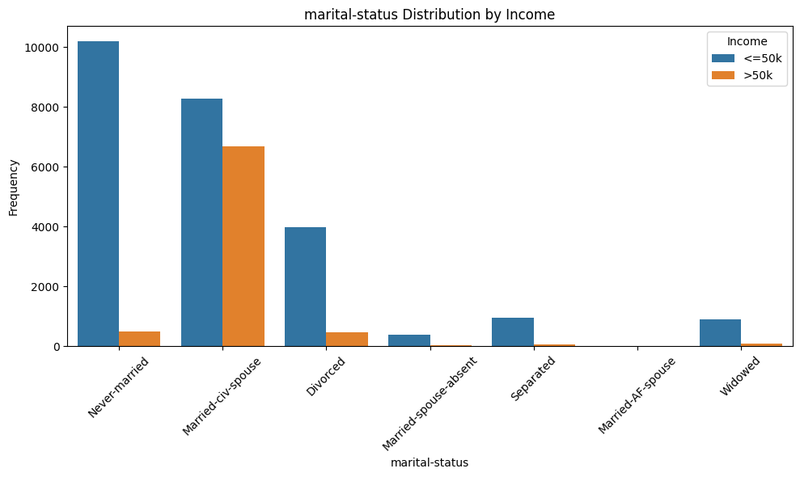
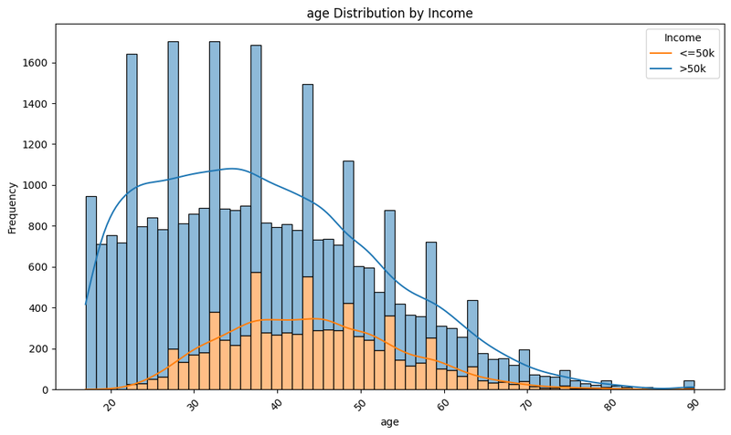
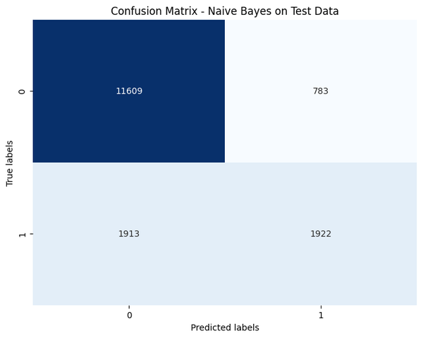
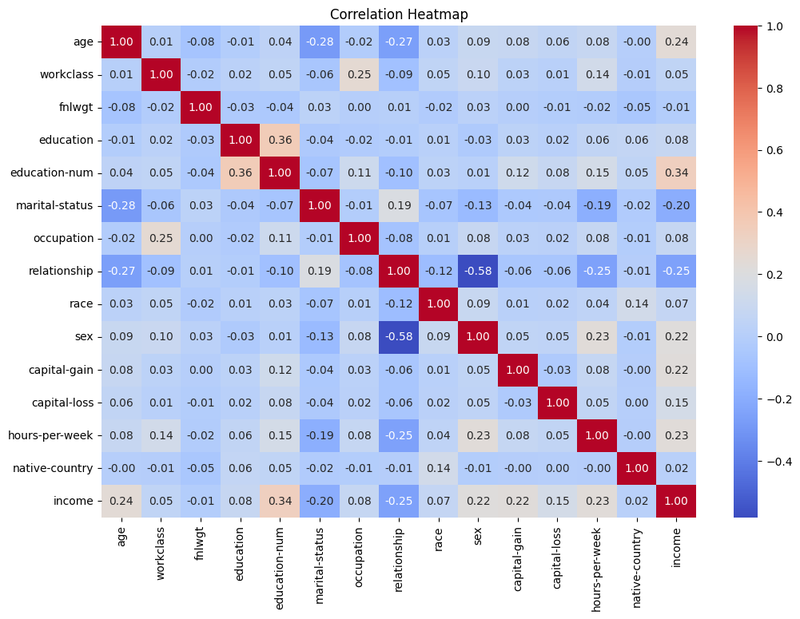

<div align="center">

# 💼 Adult Census Income Prediction: Naive Bayes vs Random Forest

**Machine Learning coursework: predicting whether a person earns more than $50K a year from 1994 US Census data, with full cleaning, class balancing and model comparison.**





</div>

---

## 📌 Overview

Uses the [UCI Adult dataset](https://archive.ics.uci.edu/dataset/2/adult) (32,561 training and 16,281 test records) to classify income as **≤50K** or **>50K**, and compares a probabilistic model (**Gaussian Naive Bayes**) with an ensemble model (**Random Forest**).

## 🧹 Pipeline

1. **Load** the train / test splits directly from the UCI repository
2. **Exploratory analysis:** distributions of every feature split by income class, plus a correlation heatmap
3. **Cleaning**
   - `?` treated as missing and imputed with the column **mode**
   - Duplicates removed and text normalised to lowercase
   - `native-country` binarised (United States vs other)
   - `capital-gain − capital-loss` combined into a single **`total-capital`** feature
   - Redundant `fnlwgt` and `education` dropped (`education-num` kept)
4. **Label encoding** of categorical features
5. **SMOTE oversampling** to balance the training classes (24,594 records per class)
6. **Train and evaluate** both models on the official test set: classification reports, confusion matrices, ROC and precision-recall curves

## 📈 Results (test set, 16,227 records)

| Model | Accuracy | ROC-AUC | >50K Precision | >50K Recall | >50K F1 |
|---|:-:|:-:|:-:|:-:|:-:|
| Gaussian Naive Bayes | **83.4%** | 0.867 | **0.71** | 0.50 | 0.59 |
| Random Forest | 83.1% | **0.889** | 0.62 | **0.72** | **0.67** |

Overall accuracy is almost identical. **Random Forest ranks examples better (higher AUC) and finds far more of the high earners** (recall 0.72 vs 0.50). Naive Bayes is more conservative: fewer false alarms, but more missed high earners.

<p align="center">
  
  
</p>

<details>
<summary><b>Correlation heatmap</b></summary>
<p align="center"></p>
</details>

## 📂 Notebooks

| Notebook | Description |
|---|---|
| `notebooks/adult_income_classification.ipynb` | ⭐ **Final submission:** EDA, cleaning, SMOTE, Naive Bayes vs Random Forest, all evaluation plots |
| `archive/MLCW2.ipynb` | Second iteration with extra EDA (boxplots, pair plots, correlation heatmap, feature importance) |
| `archive/MLCW1.ipynb` | First iteration |

## 🚀 Running

```bash
pip install pandas numpy matplotlib seaborn scikit-learn imbalanced-learn
jupyter notebook notebooks/adult_income_classification.ipynb
```

The dataset is downloaded automatically from the UCI repository when the notebook runs.

---

<div align="center"><sub>Built by <a href="https://github.com/minudakaliyanage">Minudaka Liyanage</a></sub></div>
